# Predicción de Pago a Tiempo en Créditos de Consumo

> Pipeline MLOps de punta a punta que estima, **antes del desembolso**, la probabilidad de que una solicitud de crédito se pague a tiempo. Su propósito es identificar a los clientes con mayor riesgo de incumplimiento, exponer el modelo como un servicio y monitorear de forma continua el *data drift*.


---

## Resumen ejecutivo

| Aspecto | Resultado |
|---|---|
| **Problema** | 1 de cada 21 créditos (4,75%) no se paga a tiempo y hoy no existe una estimación cuantitativa del riesgo de cada solicitud |
| **Datos** | 10.763 créditos, 23 variables, entre noviembre de 2024 y abril de 2026 |
| **Hallazgo crítico** | La variable `puntaje` produce *data leakage*: por sí sola alcanza ROC-AUC = 1,0. Se excluyó |
| **Modelo seleccionado** | Regresión Logística con ponderación de clases |
| **Desempeño** | ROC-AUC 0,686 en validación cruzada y 0,633 en evaluación *out-of-time*. Detecta el **61%** de los clientes que no pagan |
| **Despliegue** | API FastAPI con predicción por lotes (JSON y CSV), empaquetada en Docker |
| **Monitoreo** | PSI, KS, Chi² y Jensen-Shannon por mes. En enero de 2026 el sistema recomienda **reentrenar** el modelo |
| **Calidad** | 32 pruebas automáticas, 95% de cobertura, análisis en SonarCloud y pipeline CI/CD en Jenkins |

---

## Tabla de contenido

1. [Planteamiento del problema](#1-planteamiento-del-problema)
2. [Objetivos](#2-objetivos)
3. [Datos](#3-datos)
4. [Metodología](#4-metodología)
5. [Arquitectura](#5-arquitectura)
6. [Estructura del repositorio](#6-estructura-del-repositorio)
7. [Análisis exploratorio](#7-análisis-exploratorio)
8. [Limpieza e ingeniería de características](#8-limpieza-e-ingeniería-de-características)
9. [Modelado y evaluación](#9-modelado-y-evaluación)
10. [Monitoreo y data drift](#10-monitoreo-y-data-drift)
11. [Despliegue: API y Docker](#11-despliegue-api-y-docker)
12. [Calidad: pruebas y SonarCloud](#12-calidad-pruebas-y-sonarcloud)
13. [CI/CD con Jenkins](#13-cicd-con-jenkins)
14. [Registro de decisiones](#14-registro-de-decisiones)
15. [Instalación y uso](#15-instalación-y-uso)
16. [Flujo de trabajo con Git](#16-flujo-de-trabajo-con-git)
17. [Conclusiones](#17-conclusiones)
18. [Limitaciones y trabajo futuro](#18-limitaciones-y-trabajo-futuro)
19. [Autor](#19-autor)

---

## 1. Planteamiento del problema

### Contexto

Una entidad que otorga **créditos de consumo** recibe miles de solicitudes al año. Para cada una dispone de tres fuentes de información:

| Fuente | Información |
|---|---|
| **El cliente** | Edad, tipo de vinculación laboral, salario y deudas con otras entidades |
| **El crédito** | Tipo de producto, monto, plazo y cuota pactada |
| **El buró (Datacrédito)** | Puntaje, créditos vigentes, consultas recientes, saldos, moras e ingresos estimados |

### Problema

Aproximadamente **1 de cada 21 créditos no se paga a tiempo**. Cada uno representa pérdida de capital, costos de cobranza y deterioro de la cartera, y hoy la aprobación se decide sin una medida consistente del riesgo.

### Pregunta de negocio

> **Con la información disponible al momento de la solicitud, ¿qué tan probable es que este cliente pague a tiempo?** Y, en consecuencia, ¿qué clientes tienen mayor riesgo de **no** hacerlo?

### Por qué es un reto

| Reto | Consecuencia |
|---|---|
| Clases muy desbalanceadas (95% / 5%) | La *accuracy* engaña: decir "todos pagan" acierta el 95% |
| Datos reales con errores | Hay valores imposibles, valores centinela, texto mal digitado y nulos no aleatorios |
| Riesgo de *data leakage* | Una variable solo se conoce después del resultado |
| Población cambiante | El perfil de los clientes evoluciona y degrada cualquier modelo que no se monitoree |

---

## 2. Objetivos

**Objetivo general.** Construir un modelo supervisado de clasificación binaria que estime la probabilidad de pago a tiempo de cada solicitud, empaquetado en un pipeline reproducible, desplegado como servicio y monitoreado en el tiempo.

**Objetivos específicos**

1. Comprender y depurar los datos, documentando reglas de validación reutilizables.
2. Diseñar un pipeline de ingeniería de características libre de *data leakage*.
3. Entrenar y comparar varios algoritmos con criterios de **desempeño, consistencia y escalabilidad**.
4. Detectar cambios en la población (*data drift*) y recomendar acciones automáticamente.
5. Desplegar el modelo como una API con predicción por lotes dentro de un contenedor Docker.
6. Asegurar la calidad con pruebas automáticas, análisis estático (SonarCloud) e integración continua (Jenkins).

---

## 3. Datos

| Atributo | Valor |
|---|---|
| Archivo | `Base_de_datos.csv` (convertido desde el Excel original con `pandas`) |
| Registros | 10.763 créditos |
| Variables | 23 (22 predictoras + 1 objetivo) |
| Periodo | 26-nov-2024 a 26-abr-2026 |
| Variable objetivo | `Pago_atiempo`: **1 = pagó a tiempo, 0 = no pagó a tiempo** |
| Pagaron a tiempo (1) | 10.252 (95,25%) |
| No pagaron a tiempo (0) | 511 (4,75%) |

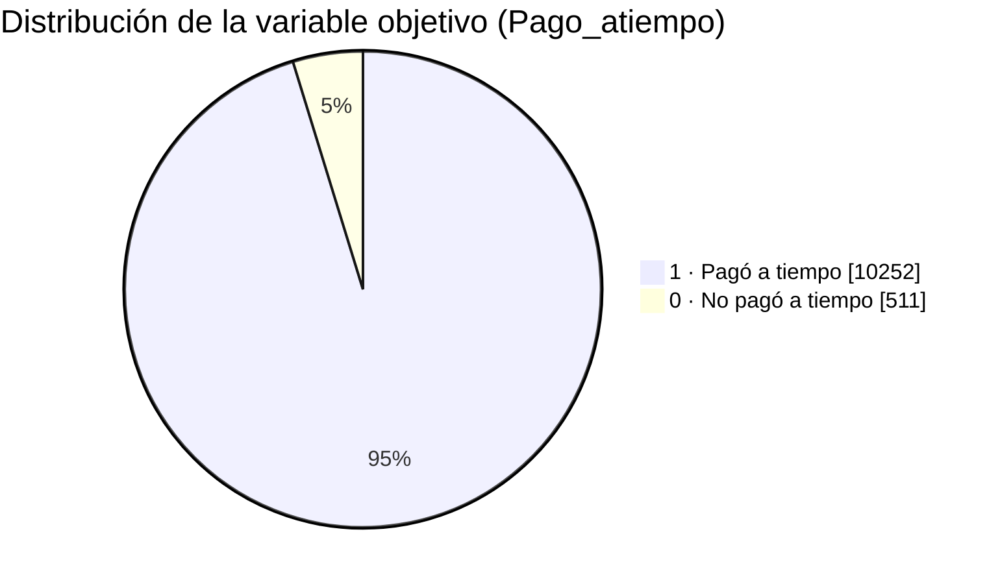

> **Convención del proyecto.** La variable objetivo se usa tal como viene en los datos. El modelo estima la probabilidad de la clase 1 (pagar a tiempo). Como al negocio le interesa detectar la clase 0, las métricas de precision, recall, F1 y PR-AUC se calculan explícitamente para la clase 0 (`pos_label=0`).

### Diccionario de datos

| Variable | Tipo | Descripción |
|---|---|---|
| `tipo_credito` | Categórica nominal | Código del producto de crédito (4, 9, 10, 6, 7, 68) |
| `fecha_prestamo` | Fecha | Fecha y hora del desembolso |
| `capital_prestado` | Numérica continua | Monto desembolsado (COP) |
| `plazo_meses` | Numérica discreta | Plazo del crédito |
| `edad_cliente` | Numérica discreta | Edad del cliente |
| `tipo_laboral` | Categórica dicotómica | Empleado / Independiente |
| `salario_cliente` | Numérica continua | Ingreso mensual declarado (COP) |
| `total_otros_prestamos` | Numérica continua | Deuda declarada en otros préstamos (COP) |
| `cuota_pactada` | Numérica continua | Cuota mensual acordada (COP) |
| `puntaje` | Numérica continua | Score interno. **Excluido por data leakage** |
| `puntaje_datacredito` | Numérica discreta | Score del buró (escala oficial 150–950) |
| `cant_creditosvigentes` | Numérica discreta | Créditos activos reportados en el buró |
| `huella_consulta` | Numérica discreta | Consultas recientes al historial crediticio |
| `saldo_mora` | Numérica continua | Saldo en mora reportado en el buró |
| `saldo_total` | Numérica continua | Saldo total de obligaciones en el buró |
| `saldo_principal` | Numérica continua | Saldo de capital. Excluido por redundancia |
| `saldo_mora_codeudor` | Numérica continua | Mora como codeudor. Excluido por ser casi constante |
| `creditos_sectorFinanciero` | Numérica discreta | Obligaciones con el sector financiero |
| `creditos_sectorCooperativo` | Numérica discreta | Obligaciones con el sector cooperativo |
| `creditos_sectorReal` | Numérica discreta | Obligaciones con el sector real (comercio) |
| `promedio_ingresos_datacredito` | Numérica continua | Ingreso estimado por el buró |
| `tendencia_ingresos` | Categórica ordinal | Decreciente < Estable < Creciente |
| `Pago_atiempo` | Dicotómica | **Variable objetivo** |

> El dataset no incluía un diccionario oficial: las descripciones se infirieron de los nombres y los valores, y deben confirmarse con el dueño de los datos.

---

## 4. Metodología

El proyecto sigue **CRISP-DM**, con una capa de prácticas **MLOps**:

| Fase CRISP-DM | Implementación en el repositorio |
|---|---|
| 1. Comprensión del negocio | Planteamiento del problema (este documento) |
| 2. Comprensión de los datos | `Cargar_datos.ipynb`, `comprension_eda.ipynb` |
| 3. Preparación de los datos | `ft_engineering.py` |
| 4. Modelado | `model_training_evaluation.py` |
| 5. Evaluación | `model_training_evaluation.py` |
| 6. Despliegue y monitoreo | `model_deploy.py`, `Dockerfile`, `model_monitoring.py` |
| Transversal: calidad y CI/CD | `tests/`, SonarCloud (GitHub Actions), `Jenkinsfile` |

**Principios de diseño**

| Principio | Cómo se aplica |
|---|---|
| Una sola fuente de verdad | Las reglas de limpieza, las listas de variables y el nombre del target viven en `ft_engineering.py`; los demás componentes los importan |
| Sin *train/serve skew* | La limpieza viaja **dentro** del modelo serializado, así que el modelo recibe datos crudos en cualquier entorno: entrenamiento, monitoreo o API |
| Sin *data leakage* | La imputación, el escalado y la codificación se ajustan solo con el entrenamiento, también dentro de cada fold de validación cruzada |
| Reproducibilidad | Semillas fijas, dependencias con versión exacta, rutas independientes del directorio de ejecución e imagen Docker |

---

## 5. Arquitectura

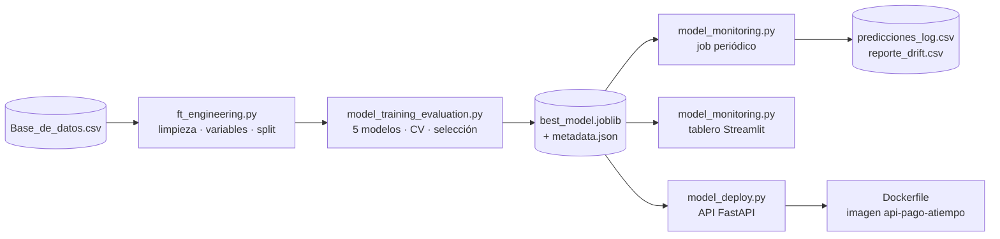

El modelo guardado es un único `Pipeline` de scikit-learn:

```
Pipeline
├── preprocesador
│   ├── preparacion  → FunctionTransformer(limpieza + variables derivadas)
│   └── columnas     → ColumnTransformer
│       ├── numeric              → SimpleImputer(mediana) → log1p seguro → StandardScaler
│       ├── categoric            → SimpleImputer(moda) → OneHotEncoder(min_frequency=30)
│       └── categoric_ordinales  → SimpleImputer(moda) → OrdinalEncoder
└── modelo  → LogisticRegression(class_weight="balanced")
```

---

## 6. Estructura del repositorio

```
mlops_repo_nicolasraigoza/
├── .github/workflows/
│   └── sonarcloud.yml                  # Pruebas + cobertura + análisis en SonarCloud
├── mlops_pipeline/
│   ├── Cargar_datos.ipynb              # Simula la extracción desde el DWH
│   ├── comprension_eda.ipynb           # Análisis exploratorio y reglas de validación
│   ├── ft_engineering.py               # Componente 1: ingeniería de características
│   ├── model_training_evaluation.py    # Componente 2: entrenamiento y selección
│   ├── model_monitoring.py             # Componente 3: data drift (job + Streamlit)
│   ├── model_deploy.py                 # Componente 4: API de predicción (FastAPI)
│   ├── best_model.joblib               # Artefacto: pipeline entrenado
│   ├── best_model_metadata.json        # Artefacto: ficha técnica del modelo
│   ├── predicciones_log.csv            # Artefacto: datos + pronósticos de producción
│   └── reporte_drift.csv               # Artefacto: métricas de drift por periodo
├── tests/                              # 32 pruebas automáticas (pytest)
│   ├── conftest.py
│   ├── test_estructura.py
│   ├── test_ft_engineering.py
│   ├── test_model_training.py
│   ├── test_model_monitoring.py
│   └── test_model_deploy.py
├── Base_de_datos.csv                   # Datos crudos (no se modifican)
├── Dockerfile                          # Imagen de la API
├── .dockerignore
├── Jenkinsfile                         # Pipeline CI/CD
├── sonar-project.properties            # Configuración de SonarCloud
├── requirements.txt                    # Dependencias con versión fija
├── setup.bat                           # Configuración del entorno en Windows
├── .gitignore
└── readme.md
```

---

## 7. Análisis exploratorio

### 7.1 Calidad de los datos

| Problema detectado | Registros | Tratamiento |
|---|---|---|
| Edades de 121 a 123 años (144 exactamente en 122: valor centinela del sistema) | 150 | → nulo |
| Salarios en 0 o mayores a 100 millones mensuales (hasta 22.000 millones) | 98 | → nulo |
| Puntaje Datacrédito fuera de la escala oficial 150–950 | 153 | → nulo |
| Valores numéricos digitados en `tendencia_ingresos` | 58 | → nulo |
| Sin información de ingresos en el buró (`promedio_ingresos_datacredito`) | 2.930 | Imputación + variable `sin_info_buro` |
| Nulos en `saldo_mora` y `saldo_total` | 156 | Imputación por mediana |
| Filas duplicadas | 0 | — |

Los valores inválidos se marcan como nulos en lugar de eliminar filas, porque así no se pierde el resto de la información del crédito. Después se imputan dentro del pipeline, con estadísticos calculados solo sobre el entrenamiento.

### 7.2 Data leakage

La variable `puntaje` separa las clases de forma **perfecta**: por sí sola alcanza **ROC-AUC = 1,0**, y las 9.407 filas con valor 95,23 corresponden, sin excepción, a clientes que pagaron. Un score así se calcula después de conocer el comportamiento de pago y no estaría disponible al momento de la solicitud. **Se excluyó del modelo.**

### 7.3 Nulos no aleatorios

Los 2.930 registros sin `promedio_ingresos_datacredito` tampoco tienen `tendencia_ingresos`: son clientes sin información de ingresos en el buró (*thin file*). Su tasa de no pago es de 5,7%, frente a 4,4% en los que sí tienen información. El patrón se convirtió en una variable explícita (`sin_info_buro`).

### 7.4 Tipo de distribución de las variables numéricas

Cada variable se clasificó con reglas reproducibles: asimetría, curtosis, si es de conteo, simetría después del logaritmo y la prueba de normalidad de D'Agostino.

| Distribución | Variables |
|---|---|
| Simétrica y aplanada (entre normal y uniforme) | `edad_cliente` (skew 0,27, kurtosis −0,86) |
| Log-normal | `capital_prestado`, `salario_cliente`, `cuota_pactada` |
| Discreta de conteo, sesgada a la derecha | `plazo_meses`, `cant_creditosvigentes`, `huella_consulta`, `creditos_sectorFinanciero`, `creditos_sectorCooperativo`, `creditos_sectorReal` |
| Sesgada a la derecha con colas muy pesadas | `total_otros_prestamos`, `saldo_mora`, `saldo_total`, `saldo_principal`, `promedio_ingresos_datacredito` |
| Sesgada a la izquierda | `puntaje_datacredito` |

**Conclusión:** ninguna variable es gaussiana, y los montos tienen asimetrías de hasta 40. Por eso se imputa con la **mediana**, que es robusta ante valores extremos, y se aplica **logaritmo** antes de escalar.

### 7.5 Relaciones con la variable objetivo

| Variable | Pagó a tiempo (1) | No pagó (0) | Lectura |
|---|---|---|---|
| Edad (mediana) | 42 años | 37 años | Los más jóvenes incumplen más |
| Puntaje Datacrédito (mediana) | 792 | 769 | Peor puntaje, más riesgo |
| Consultas al buró (mediana) | 4 | 5 | Buscar crédito en muchas partes es una señal de riesgo |
| Capital prestado (mediana) | 1,91 M | 2,27 M | Montos mayores, más riesgo |

| Segmento | Tasa de no pago |
|---|---|
| Ingresos con tendencia decreciente | 6,3% |
| Ingresos estables | 4,6% |
| Ingresos con tendencia creciente | 3,9% |
| Independientes | 5,5% |
| Empleados | 4,3% |

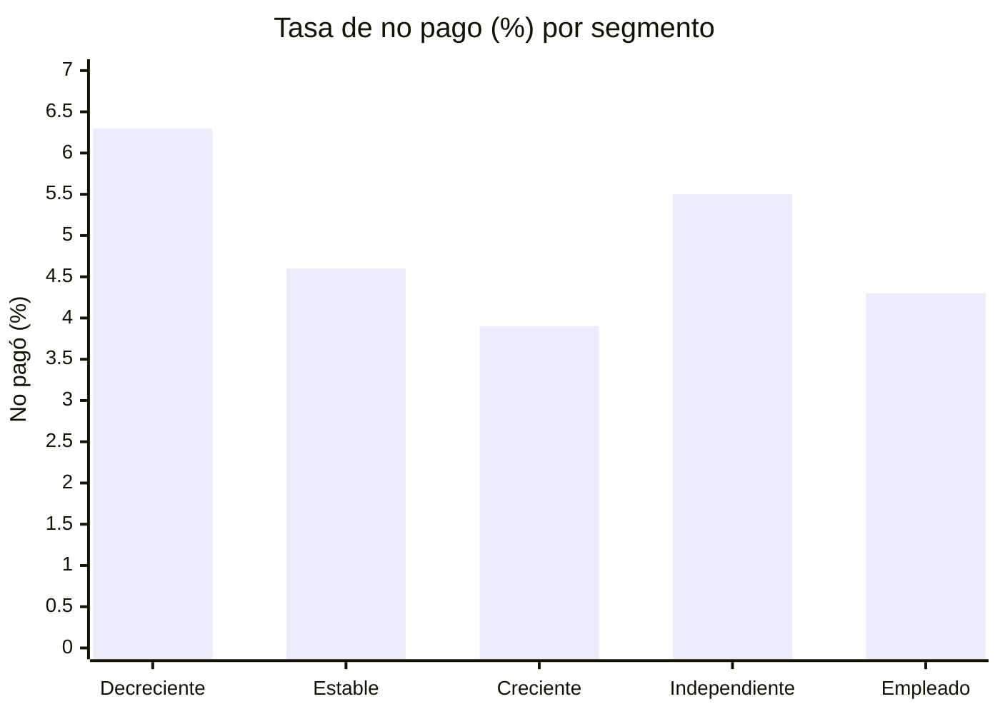

### 7.6 Relaciones entre variables

- **Redundancia:** `saldo_total` y `saldo_principal` tienen una correlación de Spearman de 0,95, así que se conserva solo una.
- **Capital vs cuota:** tienen una correlación de 0,76. En el gráfico de dispersión en escala log-log, coloreado por `Pago_atiempo` y con la forma del punto según `tipo_laboral`, los créditos forman **bandas diagonales, una por cada plazo**. Los clientes que no pagan aparecen **mezclados** con los que pagan, sin una región propia. Esto confirma que la señal predictiva es moderada.

---

## 8. Limpieza e ingeniería de características

### 8.1 Flujo de transformación

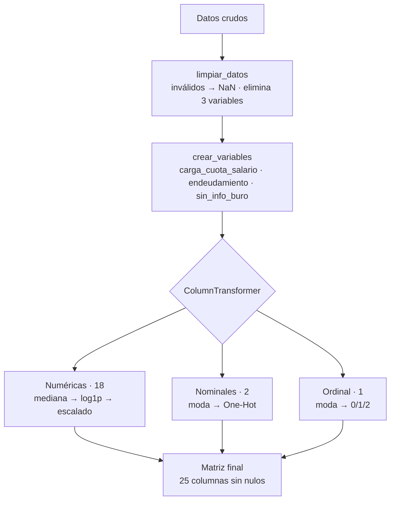

### 8.2 Reglas de validación

| Variable | Regla |
|---|---|
| `edad_cliente` | Entre 18 y 100 |
| `salario_cliente` | Entre 1 y 100.000.000 |
| `puntaje_datacredito` | Entre 150 y 950 |
| `tendencia_ingresos` | ∈ {Decreciente, Estable, Creciente} |
| `tipo_credito` | Se convierte a texto: es un código, no una cantidad |

### 8.3 Variables eliminadas

| Variable | Motivo |
|---|---|
| `puntaje` | *Data leakage* (ROC-AUC = 1,0 por sí sola) |
| `saldo_mora_codeudor` | Casi constante: solo 3 registros mayores que 0 |
| `saldo_principal` | Redundante con `saldo_total` (Spearman 0,95) y con más nulos (405) |

### 8.4 Variables derivadas

| Variable | Fórmula | Intuición de negocio |
|---|---|---|
| `carga_cuota_salario` | cuota / salario | Capacidad de pago: qué parte del ingreso compromete la cuota |
| `endeudamiento` | otros préstamos / salario | Apalancamiento total del cliente |
| `sin_info_buro` | 1 si no hay ingresos en el buró | Cliente sin historial (*thin file*) |

### 8.5 Transformaciones

| Tipo | Imputación | Transformación | Por qué |
|---|---|---|---|
| Numéricas (18) | Mediana | `log1p` protegido contra negativos → `StandardScaler` | Distribuciones sesgadas: el logaritmo las vuelve más simétricas y la escala las pone en el mismo rango |
| Nominales (2) | Moda | One-Hot; las categorías con menos de 30 casos se agrupan en "infrequent" | Evita columnas casi vacías, y una categoría nueva en producción no genera error |
| Ordinal (1) | Moda | Decreciente = 0 < Estable = 1 < Creciente = 2 | Respeta el orden natural de la variable |

### 8.6 Estrategia de validación: *out-of-time*

| Conjunto | Periodo | Registros | Pagaron a tiempo (1) | No pagaron (0) |
|---|---|---|---|---|
| Entrenamiento | nov-2024 → may-2025 | 7.713 (72%) | 94,68% | 5,32% |
| Evaluación | jun-2025 → abr-2026 | 3.050 (28%) | 96,69% | 3,31% |

Se entrena con el pasado y se evalúa con el futuro, que es como se usará el modelo en la realidad. Es el estándar en riesgo de crédito y es más exigente que una partición aleatoria: con una partición al azar, el modelo "conocería" las condiciones de los meses que luego debe predecir.

---

## 9. Modelado y evaluación

### 9.1 Modelos comparados

Todos usan el mismo preprocesador y ponderación de clases para compensar el desbalance:

| Modelo | Idea | Configuración principal |
|---|---|---|
| Baseline (Dummy) | No aprende; es el piso de referencia | `strategy="prior"` |
| Regresión Logística | Suma ponderada de las variables → probabilidad | `class_weight="balanced"` |
| Árbol de Decisión | Preguntas encadenadas | `max_depth=5`, `min_samples_leaf=50` |
| Random Forest | 300 árboles que votan | `max_depth=6`, `balanced_subsample` |
| Gradient Boosting | Árboles en secuencia que corrigen errores | `learning_rate=0.03`, regularización L2 |

### 9.2 Métricas

- **Selección:** ROC-AUC en validación cruzada estratificada de 5 folds, sobre el entrenamiento.
- **Reporte final**, sobre el conjunto de evaluación: ROC-AUC, más PR-AUC, recall, precision y F1 de la **clase 0**.
- La *accuracy* se reporta solo como referencia: el baseline alcanza 96,7% sin detectar a un solo cliente que no paga.

### 9.3 Resultados

| Modelo | AUC CV (± std) | AUC train | Brecha train−CV | AUC test | PR-AUC clase 0 | Recall clase 0 | Entrenamiento |
|---|---|---|---|---|---|---|---|
| Random Forest | 0,692 ± 0,008 | 0,847 | 0,155 ❌ | 0,657 | 0,079 | 0,44 | ~1,2 s |
| **Regresión Logística** | **0,686 ± 0,020** | **0,707** | **0,021 ✅** | **0,633** | **0,080** | **0,61** | **~0,07 s** |
| Gradient Boosting | 0,677 ± 0,010 | 0,842 | 0,165 ❌ | 0,637 | 0,074 | 0,53 | ~0,9 s |
| Árbol de Decisión | 0,635 ± 0,016 | 0,740 | 0,105 ❌ | 0,636 | 0,064 | 0,73 | ~0,07 s |
| Baseline (Dummy) | 0,500 ± 0,000 | 0,500 | 0,000 | 0,500 | 0,033 | 0,00 | ~0,04 s |

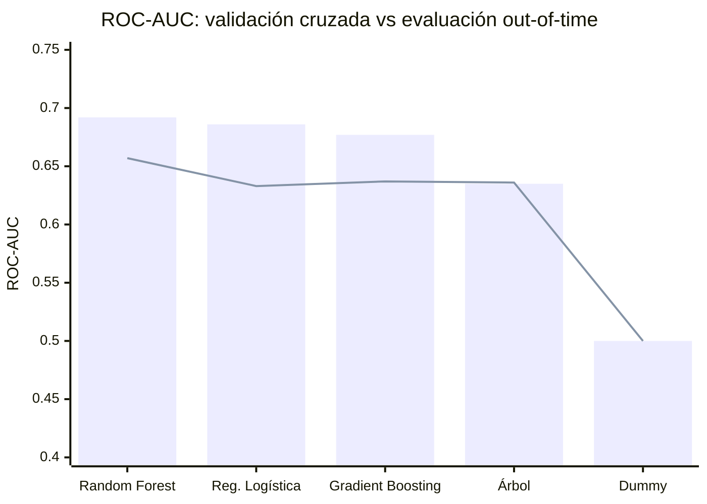

*Barras: AUC en validación cruzada. Línea: AUC en evaluación.*

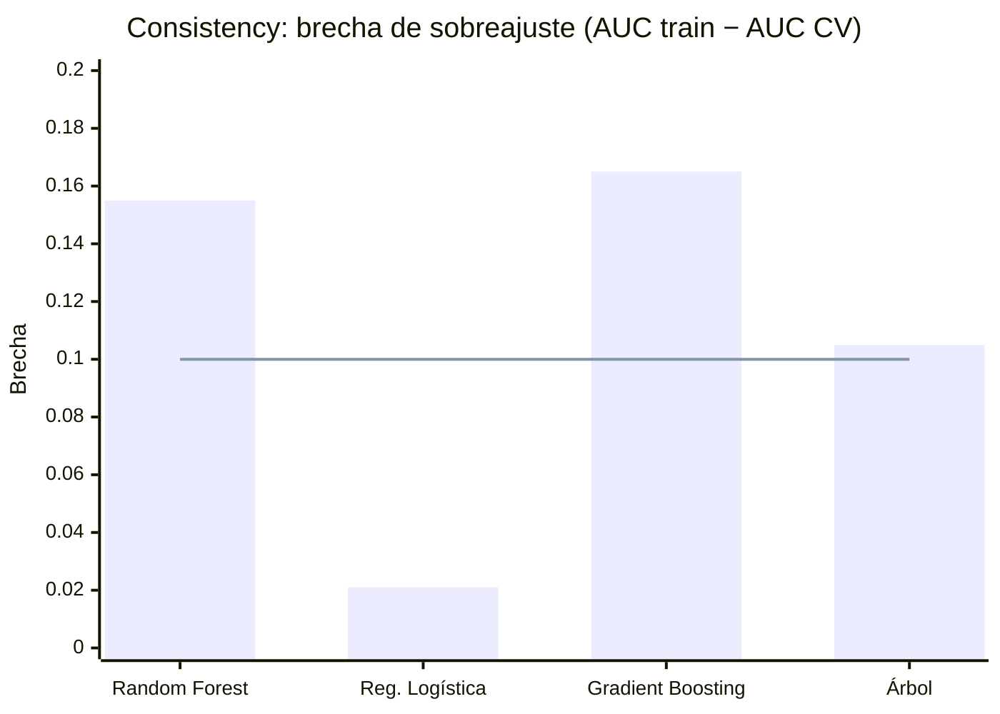

*La línea marca el máximo permitido (0,10).*

### 9.4 Criterio de selección

| Orden | Criterio | Regla aplicada |
|---|---|---|
| 1 | **Consistency** | Se descartan los modelos con brecha train−CV mayor a 0,10 (sobreajuste) |
| 2 | **Performance** | Entre los consistentes, se elige el mayor ROC-AUC en validación cruzada |
| 3 | **Scalability** | Ante un empate técnico (diferencia menor a 0,01), gana el más rápido |

**Modelo seleccionado: Regresión Logística.**
- Alcanza prácticamente el mismo AUC que el Random Forest (0,686 vs 0,692), pero **sin sobreajuste** (brecha de 0,02 vs 0,16).
- Entrena **más de 10 veces más rápido**.
- Es **interpretable**, una propiedad muy valorada en decisiones de crédito.

### 9.5 Desempeño del modelo final (evaluación, umbral 0,5)

Regla de decisión: se predice 1 (pagará) si la probabilidad de pago es ≥ 0,5; si no, se predice 0.

| Real \ Predicho | 0 · No pagará | 1 · Pagará |
|---|---|---|
| **0 · No pagó a tiempo** | **62** ✅ | 39 |
| **1 · Pagó a tiempo** | 1.383 | **1.566** ✅ |

| Métrica (clase 0) | Valor | Lectura |
|---|---|---|
| Recall | 0,61 | Detecta 62 de los 101 clientes que no pagaron |
| Precision | 0,043 | Por cada cliente riesgoso detectado hay unas 22 alertas a clientes que sí pagan |
| PR-AUC | 0,080 | Es **2,4 veces** la tasa base de no pago (0,033): concentra el riesgo mejor que el azar |
| Balanced accuracy | 0,57 | Por encima del 0,50 del azar |

**Uso recomendado:** priorizar revisiones manuales y ajustar las condiciones del crédito, no rechazar de forma automática.

### 9.6 Interpretación del modelo

Los coeficientes se refieren a la clase 1: un coeficiente positivo **aumenta** la probabilidad de pagar a tiempo y uno negativo la **reduce**.

| Aumentan la probabilidad de pago (+) | Reducen la probabilidad de pago (−) |
|---|---|
| Tipo de crédito 10 (+0,79) | Productos poco frecuentes (−1,16) |
| Puntaje Datacrédito (+0,33) | Consultas recientes al buró (−0,42) |
| Créditos vigentes en el buró (+0,29) | No tener información en el buró (−0,23) |
| Tendencia de ingresos creciente (+0,22) | Ser independiente (−0,20) |
| Tipo de crédito 4 (+0,20) | Carga de la cuota sobre el salario (−0,13) |

`capital_prestado` (+1,81), `cuota_pactada` (−1,90) y `plazo_meses` (−1,31) tienen coeficientes grandes porque están fuertemente relacionadas entre sí. Deben leerse en conjunto: **una cuota alta respecto del monto prestado reduce la probabilidad de pago**.

---

## 10. Monitoreo y data drift

### 10.1 Diseño

`model_monitoring.py` simula la operación en producción desde el 1 de junio de 2025:

1. **Tabla de datos + pronósticos:** cada crédito con su probabilidad y su decisión (`predicciones_log.csv`).
2. **Muestreo periódico mensual:** hasta 500 registros por mes. Se omiten los meses con menos de 100, porque en muestras pequeñas el ruido infla las métricas.
3. **Comparación contra la referencia**, que son los datos de entrenamiento.

| Métrica | Aplica a | Qué mide | Umbral |
|---|---|---|---|
| **PSI** | Todas | Magnitud del cambio en la distribución | 🟢 < 0,10 · 🟡 0,10–0,25 · 🔴 ≥ 0,25 |
| **Kolmogorov-Smirnov** | Numéricas | Significancia estadística del cambio | p < 0,05 |
| **Chi-cuadrado** | Categóricas | Significancia estadística del cambio | p < 0,05 |
| **Jensen-Shannon** | Todas | Distancia entre distribuciones (0 a 1) | Referencial |

Se monitorean tres tipos de cambio:
- las variables de entrada (*data drift*);
- la **probabilidad de pago predicha** (*prediction drift*);
- el **ROC-AUC mensual**, cuando ya se conoce el resultado real (*concept drift*).

**Detalle técnico.** En variables con muchos ceros, como `saldo_mora`, los cuantiles coinciden y todo caería en una sola caja, con lo que el PSI daría siempre 0. En ese caso la variable se binariza en "cero vs mayor que cero".

### 10.2 Resultados

| Periodo | Muestra | 🔴 Críticas | 🟡 Moderadas | PSI predicción | No pago real | Predichos "no pagará" | AUC real |
|---|---|---|---|---|---|---|---|
| 2025-06 | 500 | 2 | 1 | 0,03 | 3,8% | 38% | 0,66 |
| 2025-07 | 500 | 2 | 3 | 0,10 | 3,1% | 48% | 0,72 |
| 2025-08 | 500 | 5 | 3 | 0,14 | 3,6% | 48% | 0,61 |
| 2025-09 | 361 | 3 | 2 | 0,09 | 1,9% | 48% | 0,70 |
| 2025-10 | 231 | 3 | 8 | 0,25 | 1,7% | 52% | 0,63 |
| 2025-11 | 166 | 3 | 6 | 0,15 | 4,2% | 50% | 0,46 |
| 2025-12 | 174 | 5 | 5 | 0,31 | 1,7% | 56% | 0,61 |
| 2026-01 | 127 | 6 | 4 | **0,51** | 5,5% | 65% | 0,57 |

*Febrero, marzo y abril de 2026 se omiten del análisis de drift porque tienen menos de 100 créditos.*

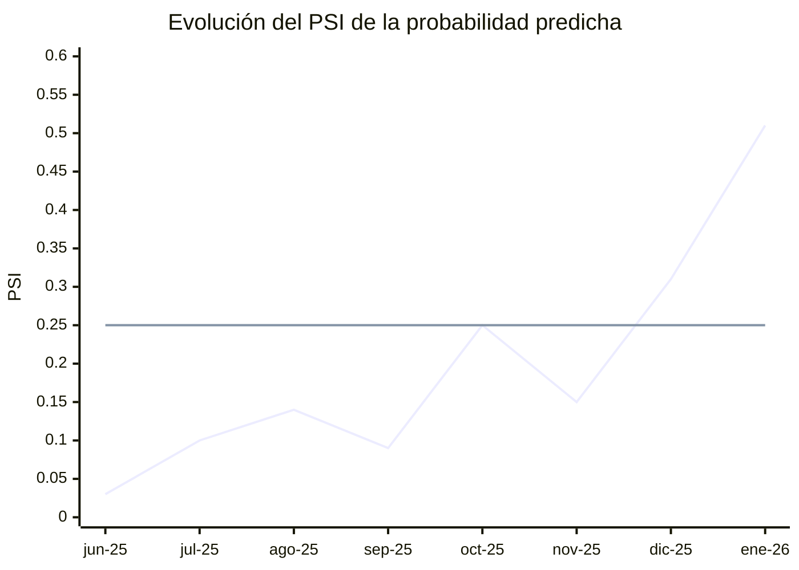

*La línea horizontal marca el umbral crítico (0,25).*

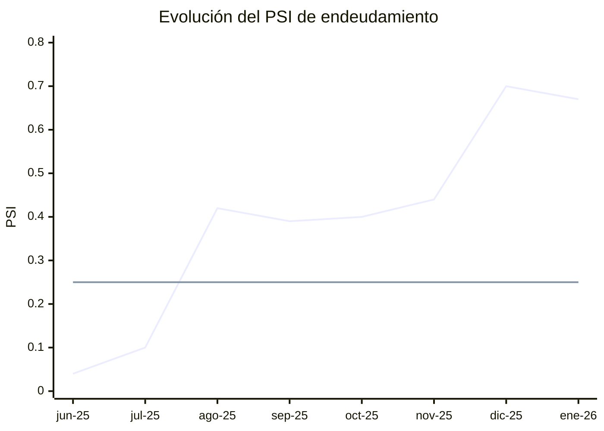

| Variable con mayor deriva | PSI inicial (jun-25) | PSI máximo |
|---|---|---|
| `promedio_ingresos_datacredito` | 0,37 | 3,25 (ene-26) |
| `endeudamiento` | 0,04 | 0,70 (dic-25) |
| `probabilidad_pago` (predicción) | 0,03 | 0,51 (ene-26) |
| `plazo_meses` | — | 0,47 |
| `capital_prestado` | 0,06 | 0,35 (dic-25) |

**Lectura**

- El modelo arranca estable, y la población **se aleja progresivamente** de la de entrenamiento.
- La proporción de clientes clasificados como "no pagará" sube de 38% a 65%, mientras que la tasa real de no pago se mantiene entre 2% y 6%. El modelo se vuelve **cada vez más pesimista** porque los clientes nuevos se parecen menos a los del entrenamiento.
- En enero de 2026 el sistema emite la recomendación de **reentrenar el modelo**.
- Esto es coherente con la caída del AUC entre la validación cruzada (0,69) y la evaluación *out-of-time* (0,63).

### 10.3 Tablero en Streamlit

| Pestaña | Contenido |
|---|---|
| 🚦 Drift por variable | Tabla de métricas, semáforo y barras de riesgo |
| 📈 Distribuciones | Histórico vs actual para cualquier variable |
| ⏱️ Evolución temporal | PSI en el tiempo, cambios abruptos, tendencias y desempeño real |
| 🔔 Alertas y recomendaciones | Mensajes automáticos de revisión o reentrenamiento |

Además tiene 4 indicadores clave (variables críticas, variables moderadas, PSI de la predicción y AUC del periodo) y un selector del periodo en la barra lateral.

El mismo archivo funciona de dos formas: como **job** (`python ...`), que genera los reportes en CSV, y como **tablero** (`streamlit run ...`).

---

## 11. Despliegue: API y Docker

### 11.1 API con FastAPI

`model_deploy.py` expone el mejor modelo como un servicio web. Carga el pipeline completo (`best_model.joblib`), así que recibe **datos crudos** y aplica internamente la misma limpieza del entrenamiento.

| Método | Endpoint | Entrada | Salida |
|---|---|---|---|
| GET | `/health` | — | Estado del servicio y modelo cargado |
| POST | `/predict` | JSON `{"registros": [ {...}, {...} ]}` (1 a 20.000 registros) | Probabilidad de pago, predicción 0/1 y texto por registro |
| POST | `/predict/csv` | Archivo CSV con el formato de `Base_de_datos.csv` (máx. 5 MB) | Igual que `/predict` |

Ejemplo de respuesta (predicción por lotes, salida estructurada):

```json
{
  "modelo": "Regresión Logística",
  "variable_objetivo": "Pago_atiempo (1 = pagó a tiempo, 0 = no pagó a tiempo)",
  "umbral_decision": 0.5,
  "n_registros": 2,
  "predicciones": [
    {"indice": 0, "probabilidad_pago": 0.6354, "prediccion": 1, "resultado": "Pagará a tiempo"},
    {"indice": 1, "probabilidad_pago": 0.4022, "prediccion": 0, "resultado": "No pagará a tiempo"}
  ]
}
```

| Validación | Respuesta |
|---|---|
| Tipos incorrectos (por ejemplo, una edad en texto) o una lista vacía | `422` (Pydantic) |
| CSV vacío, mal formado o con más de 20.000 filas | `400` |
| Archivo mayor a 5 MB | `413` |
| Campos faltantes | Se tratan como nulos y el pipeline los imputa |
| Columna `Pago_atiempo` presente en el CSV | Se descarta antes de predecir |

El CSV completo (10.763 créditos) se procesa en menos de un segundo. La documentación interactiva queda en `http://localhost:8000/docs`.

### 11.2 Imagen Docker

| Decisión del `Dockerfile` | Motivo |
|---|---|
| `python:3.14-slim` | Misma versión de Python del entrenamiento, en una imagen liviana |
| Copiar e instalar `requirements.txt` antes que el código | Aprovecha la caché de capas: un cambio de código no reinstala las dependencias |
| Copiar solo `mlops_pipeline/` (`.dockerignore`) | La imagen no lleva datos, notebooks ni pruebas |
| Usuario sin privilegios (`appuser`) | Seguridad: el contenedor no corre como root |
| `--host 0.0.0.0 --port 8000` | Permite recibir conexiones desde fuera del contenedor |

```bash
docker build -t api-pago-atiempo .
docker run -p 8000:8000 api-pago-atiempo
curl -X POST http://localhost:8000/predict/csv -F "archivo=@Base_de_datos.csv"
```

---

## 12. Calidad: pruebas y SonarCloud

### 12.1 Pruebas automáticas (pytest)

| Archivo | Pruebas | Qué valida |
|---|---|---|
| `test_estructura.py` | 11 | Que existan los archivos y carpetas obligatorios |
| `test_ft_engineering.py` | 6 | Carga, reglas de limpieza, variables derivadas, `log_seguro`, split temporal y matriz sin nulos |
| `test_model_training.py` | 3 | Métricas de la clase 0, comparación de 5 modelos, modelo y ficha guardados |
| `test_model_monitoring.py` | 7 | Propiedades del PSI, semáforo, Chi², Jensen-Shannon, job y app de Streamlit |
| `test_model_deploy.py` | 5 | Endpoints, lotes JSON, que CSV y JSON den lo mismo, registros incompletos y errores 400/422 |
| **Total** | **32** | **32 pasan** |

| Componente | Cobertura |
|---|---|
| `ft_engineering.py` | 88% |
| `model_training_evaluation.py` | 97% |
| `model_monitoring.py` | 97% |
| `model_deploy.py` | 98% |
| **Total** | **95%** |

```bash
pytest --cov=mlops_pipeline --cov-report=xml --cov-report=term
```

### 12.2 SonarCloud

El workflow `.github/workflows/sonarcloud.yml` se ejecuta en cada push a `developer`, `certification` y `main` y en cada Pull Request:

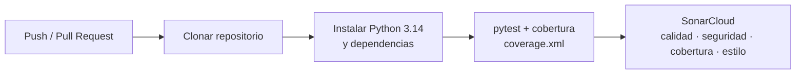

| Aspecto | Qué evalúa SonarCloud |
|---|---|
| Calidad | Bugs, *code smells*, duplicación y complejidad |
| Seguridad | Vulnerabilidades y *security hotspots* |
| Cobertura | Porcentaje de código ejecutado por las pruebas (lee `coverage.xml`) |
| Estilo | Convenciones y consistencia del código |

El token de acceso se guarda como secreto de GitHub (`SONAR_TOKEN`), nunca en el código. El análisis automático de SonarCloud está desactivado para que la cobertura llegue desde GitHub Actions.

---

## 13. CI/CD con Jenkins

El `Jenkinsfile` define un pipeline declarativo que se dispara automáticamente: `pollSCM` revisa el repositorio cada 5 minutos, así que un merge nuevo lo activa.

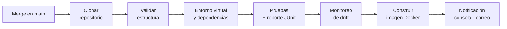

| Etapa | Qué hace | Si falla |
|---|---|---|
| Clonar repositorio | `checkout scm` | Se detiene |
| Validar estructura | Verifica los 11 archivos obligatorios y muestra OK o FALTA | Se detiene e indica qué falta |
| Dependencias | Crea un `venv` limpio e instala `requirements.txt` | Se detiene |
| Pruebas | Ejecuta las 32 pruebas y publica el reporte en Jenkins | Se detiene |
| Monitoreo | Ejecuta el job de drift | Se detiene |
| Imagen Docker | `docker build` con etiquetas `BUILD_NUMBER` y `latest` | Se detiene |
| Notificación | Siempre, al final: estado del build por consola y por correo | — |

---

## 14. Registro de decisiones

| # | Decisión | Alternativa descartada | Justificación |
|---|---|---|---|
| 1 | Usar `Pago_atiempo` tal como viene (1 = pagó) y medir la clase 0 con `pos_label=0` | Invertir el target | Respeta los datos originales sin perder el foco del negocio |
| 2 | Excluir `puntaje` | Usarlo | *Data leakage*: AUC 1,0, información posterior al resultado |
| 3 | Marcar los inválidos como NaN e imputar | Eliminar filas | No se pierde el resto de la información del crédito |
| 4 | Imputar con la mediana | Imputar con la media | Las distribuciones son sesgadas; la mediana es robusta |
| 5 | Aplicar `log1p` antes de escalar | Escalar directamente | Reduce la asimetría de los montos (log-normales) |
| 6 | Crear `sin_info_buro` | Ignorar el patrón de nulos | Los nulos no son aleatorios y tienen mayor tasa de no pago |
| 7 | Separar por fecha (*out-of-time*) | `train_test_split` aleatorio | Simula el uso real y evita la fuga temporal |
| 8 | `class_weight="balanced"` | SMOTE o submuestreo | Simple, sin datos sintéticos y sin perder registros |
| 9 | Seleccionar por consistencia → performance → velocidad | Elegir solo el mayor AUC | El Random Forest tenía el mayor AUC, pero sobreajustaba |
| 10 | Guardar limpieza + preprocesador + modelo en un solo pipeline | Guardar solo el modelo | Evita el *train/serve skew*: la API recibe datos crudos |
| 11 | Mínimo de 100 registros por periodo para el drift | Analizar todos los meses | Con muestras pequeñas el PSI genera falsas alarmas |
| 12 | Límites de 20.000 registros y 5 MB en la API | Sin límites | Protege el servicio de peticiones abusivas |

---

## 15. Instalación y uso

### Requisitos

- Python 3.14
- Git
- Docker Desktop (para la imagen y Jenkins)

### Configuración del entorno

**macOS / Linux**

```bash
git clone https://github.com/NikoRaigoza/mlops_repo_nicolasraigoza.git
cd mlops_repo_nicolasraigoza
python3 -m venv venv
source venv/bin/activate
python -m pip install -r requirements.txt
```

**Windows**

```bat
git clone https://github.com/NikoRaigoza/mlops_repo_nicolasraigoza.git
cd mlops_repo_nicolasraigoza
setup.bat
```

### Ejecución

Ejecuta los comandos desde la raíz del repositorio, con el entorno virtual activo y en este orden:

```bash
# 1. Verificar la ingeniería de características
python mlops_pipeline/ft_engineering.py

# 2. Entrenar, comparar y guardar el mejor modelo
python mlops_pipeline/model_training_evaluation.py

# 3. Ejecutar el job de monitoreo (genera los CSV de predicciones y drift)
python mlops_pipeline/model_monitoring.py

# 4. Abrir el tablero de monitoreo en http://localhost:8501
streamlit run mlops_pipeline/model_monitoring.py

# 5. Levantar la API en http://localhost:8000 (documentación en /docs)
uvicorn model_deploy:app --app-dir mlops_pipeline --reload

# 6. Ejecutar las pruebas con cobertura
pytest --cov=mlops_pipeline --cov-report=term
```

> Los archivos `.py` incluyen marcadores de celda `# %%`, así que también pueden ejecutarse por bloques en VS Code (extensión Jupyter). En entornos sin interfaz gráfica, como un servidor de CI, usa `MPLBACKEND=Agg` para que los gráficos no abran ventanas.

### Uso del modelo entrenado desde Python

```python
import joblib
import pandas as pd

modelo = joblib.load("mlops_pipeline/best_model.joblib")
solicitudes = pd.read_csv("Base_de_datos.csv").head()      # datos crudos
prob_pago = modelo.predict_proba(solicitudes)[:, 1]       # probabilidad de pagar a tiempo (clase 1)
prediccion = modelo.predict(solicitudes)                  # 1 = pagará, 0 = no pagará
```

Ejecuta este código desde `mlops_pipeline/` o agrega esa carpeta al `PYTHONPATH`: el modelo necesita importar `ft_engineering`.

---

## 16. Flujo de trabajo con Git

| Rama | Propósito |
|---|---|
| `developer` | Desarrollo activo |
| `certification` | Validación y pruebas (QA) |
| `main` | Versión estable, lista para producción |

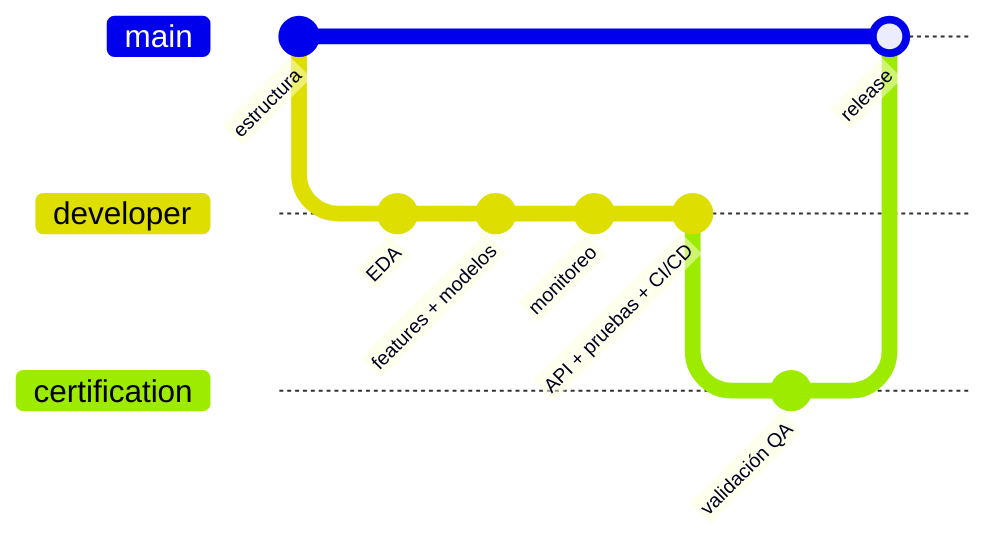

Los cambios avanzan en un solo sentido (`developer` → `certification` → `main`) mediante Pull Requests.

> El enunciado nombra la rama de producción `master`. En este repositorio la rama principal es `main` y cumple ese mismo rol.

---

## 17. Conclusiones

1. **La calidad de los datos fue decisiva.** Se detectaron valores centinela (edad 122), salarios imposibles, puntajes fuera de escala y texto mal digitado. Tratarlos como nulos e imputarlos dentro del pipeline permitió conservar todos los registros sin contaminar el modelo.
2. **Detectar el *data leakage* fue el hallazgo más importante.** Con `puntaje`, cualquier modelo habría reportado un AUC perfecto e inútil en producción. Sin esa variable, el resultado es honesto: un AUC moderado (0,63–0,69) que refleja la información realmente disponible antes del desembolso.
3. **Más complejidad no significó mejor modelo.** Random Forest y Gradient Boosting memorizaron el entrenamiento (brechas de 0,16), mientras que la Regresión Logística logró casi el mismo AUC, sin sobreajuste, más de 10 veces más rápido y con coeficientes interpretables.
4. **El modelo sirve para priorizar, no para decidir solo.** Detecta el 61% de los clientes que no pagan y concentra el riesgo 2,4 veces mejor que el azar, pero con muchas falsas alarmas. Su valor está en ordenar las solicitudes por riesgo para revisión manual o para ajustar condiciones.
5. **Las señales de riesgo coinciden con la intuición del negocio:** peor puntaje en el buró, muchas consultas recientes, ingresos decrecientes, ser independiente, no tener historial y una cuota alta respecto del monto.
6. **La población cambia, y el monitoreo lo detecta a tiempo.** A partir de agosto de 2025 varias variables muestran drift crítico, las predicciones se vuelven cada vez más pesimistas y, en enero de 2026, el sistema recomienda reentrenar. Sin monitoreo, este deterioro habría pasado desapercibido.
7. **El proyecto es reproducible y desplegable de punta a punta.** El mismo pipeline sirve para entrenar, monitorear y predecir vía API. La calidad queda respaldada por 32 pruebas (95% de cobertura), análisis en SonarCloud y un pipeline CI/CD que valida, prueba y construye la imagen en cada merge.

---

## 18. Limitaciones y trabajo futuro

| Limitación | Trabajo futuro |
|---|---|
| Señal predictiva moderada (AUC 0,63–0,69) | Incorporar variables de comportamiento (historial de pagos internos) disponibles antes del desembolso |
| Umbral de decisión provisional (0,5) | Definirlo con el negocio según el costo de prestarle a quien no paga frente a rechazar a un buen cliente |
| Probabilidades no calibradas por la ponderación de clases | Calibrar con `CalibratedClassifierCV` para que la salida sea una probabilidad real |
| Pocos eventos por mes (3 a 25 no pagos) | Leer el AUC mensual junto con el drift y agrupar trimestralmente si hace falta |
| Drift creciente desde agosto de 2025 | Reentrenamiento periódico, disparado por las alertas del monitoreo |
| Diccionario de datos inferido | Validar el significado de las variables con el dueño de los datos |
| Monitoreo sobre datos históricos simulados | Conectar el job a la base de producción y programarlo (Jenkins o *cron*) |

---

## 19. Autor

**Nicolas Raigoza Taborda**
Estudiante de Ingeniería de Sistemas — Universidad Católica Luis Amigó (Medellín, Colombia)
GitHub: [@NikoRaigoza](https://github.com/NikoRaigoza)

Proyecto final del curso de **Machine Learning**, docente Juan Sebastián Parra Sánchez.
